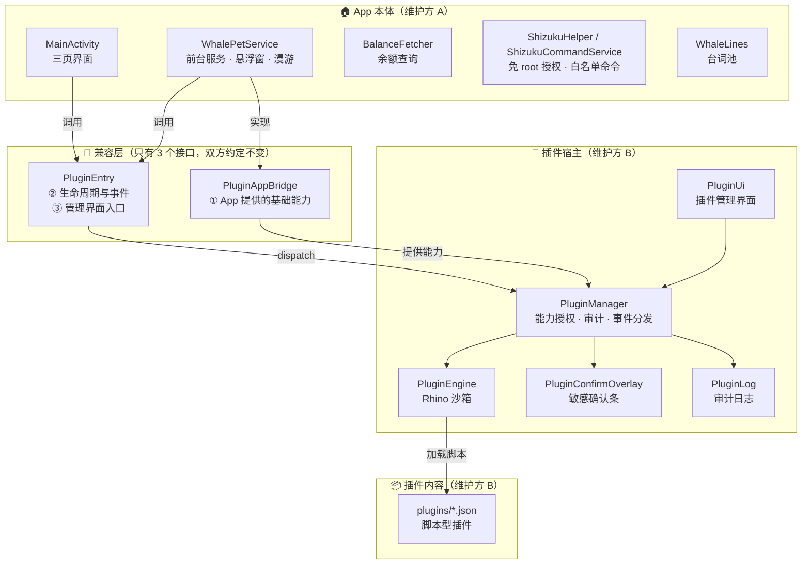
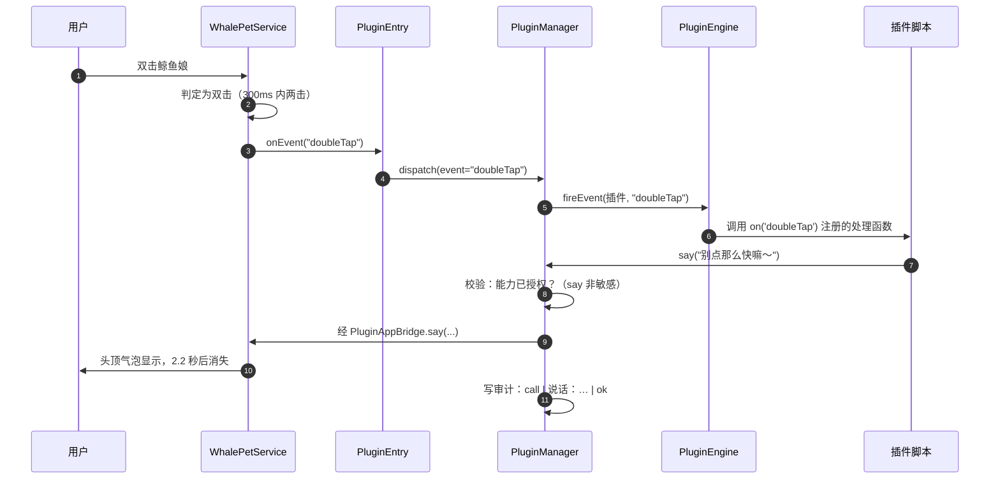
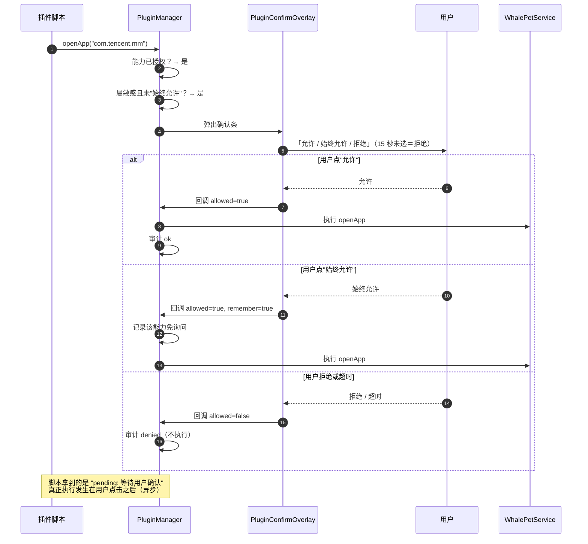
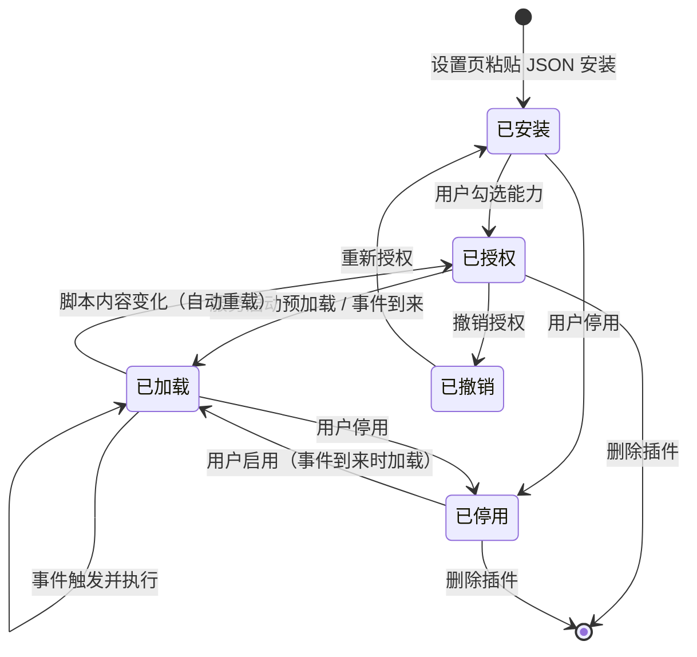
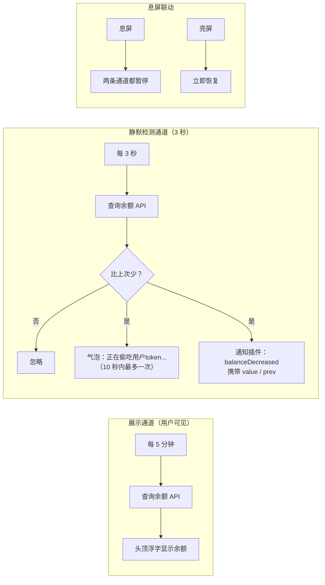
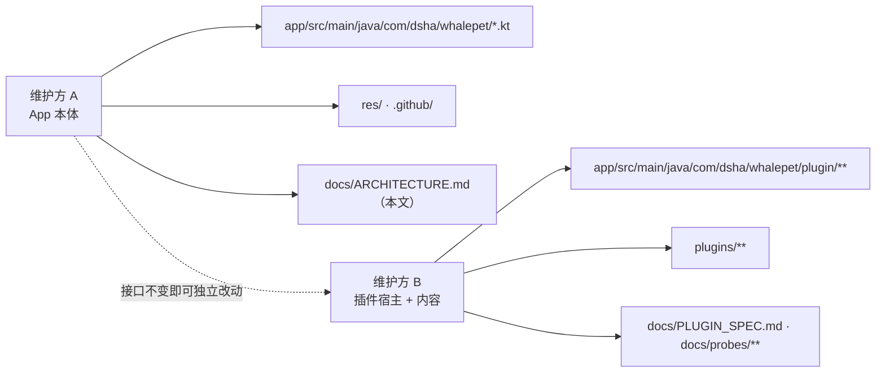

# 架构说明（ARCHITECTURE）

> 面向接手者：**用图讲清"谁调用谁、数据怎么流"**，配合 [`HANDOVER.md`](HANDOVER.md)（文件与流程）与 [`PLUGIN_SPEC.md`](PLUGIN_SPEC.md)（插件契约）阅读。
> 本文所有图均为 Mermaid 文本，GitHub 页面会自动渲染为图形。

---

## 1. 三层结构总览

App 本体与插件宿主之间**只有三个接口**；插件宿主与插件内容之间只有**一份契约**。

**读法**：`A2`（服务）实现 `B1`（能力接口）并调用 `B2`（事件入口）；`B2` 把事件交给 `C1`；`C1` 负责校验与记账，`C2` 负责执行脚本，`C4` 负责敏感确认。

---

## 2. 关键链路①：双击 → 插件说话（普通能力）

---

## 3. 关键链路②：敏感操作 → 二次确认

`openUrl` / `openApp` / `shizuku` 属敏感能力：**即使已授权，每次也要用户点头**（可选"始终允许"）。

---

## 4. 插件生命周期（状态）

---

## 5. 余额检测的数据流（两条独立通道）

---

## 6. 目录归属（维护边界）

---

## 7. 关键设计决策（为什么这样做）

| 决策 | 原因 | 代价 / 注意 |
|---|---|---|
| 悬浮窗边界用**实测偏移校准**（该机 162px） | 窗口坐标原点在状态栏下方，纯 `displayMetrics` 会算错导致触底静止 | 换设备需重新校准（代码自动做） |
| 窗口比本体大 **1.25 倍** | 点击放大时四周不被窗口裁剪 | 触摸热区比视觉略大 |
| 余额**检测与展示分离**（3 秒 / 5 分钟） | 想第一时间发现"被消耗"，又不想频繁打扰 | 每 3 秒一次网络请求（已做息屏暂停） |
| 插件脚本**只在后台单线程执行** | 既不卡 UI，又保证 Rhino 作用域线程安全 | 一个插件死循环会阻塞其它插件 |
| 沙箱用 **ClassShutter + 唯一 Java 入口** | 仅删全局变量挡不住 `__bridge.getClass()` 反射逃逸 | 新增暴露的 Java 类型必须同步进白名单 |
| 敏感能力**每次确认**（可记住） | 插件能力不小（打开应用、执行系统命令），需要用户把关 | 插件必须容忍"被拒绝" |
| 纯文档提交**不触发打包** | 否则同版本号会出现多个 APK，用户难以区分 | 文档改动不再产生构建记录 |
| 诊断/审计日志写入 **Download 且 1MB 自清除** | 真机排查第一手证据，又不会无限增长 | MediaStore 会自动补 `.txt` 后缀 |

---

## 8. 接手者最快路径（30 分钟）

1. 读 [`../AGENTS.md`](../AGENTS.md)（规矩与坑）→ 本文（结构与链路）→ [`HANDOVER.md`](HANDOVER.md)（流程与凭据）
2. 挑一条链路对照代码看：**双击→说话**（`WhalePetService` 的点击处理 → `PluginEntry.onEvent` → `PluginManager.dispatch` → `PluginEngine.fireEvent`）
3. 在真机上验证：装插件 → 双击 → 看 `Download/whale-plugins.log.txt` 是否出现 `call … ok`
4. 改一处小文案 → 提交 → 看 GitHub Actions 是否变绿 → 取 artifact 中的 APK
